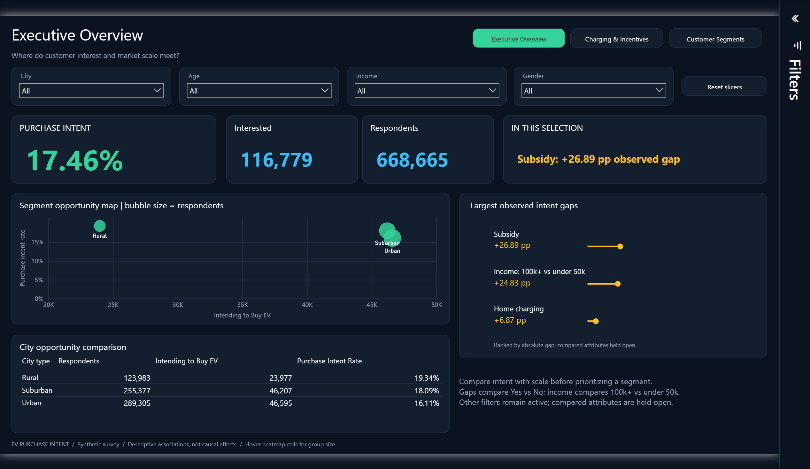
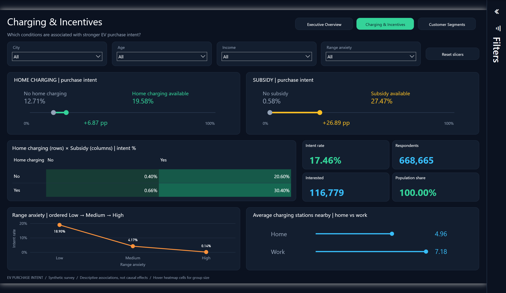
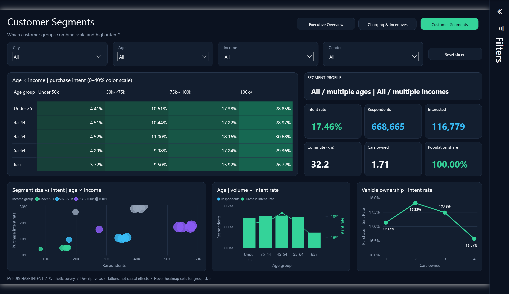

# Electric Vehicle Purchase Intent Analytics

A data pipeline and Power BI report for exploring EV purchase intent across **668,665 synthetic survey records**. The three report pages compare income, charging access, incentives and customer segments.

**Microsoft Fabric · Power BI · SQL · Python · PySpark · Airflow · Databricks · Azure DevOps**

## Business problem

Which groups express more interest in buying an EV, and how large are those groups? The report shows both the intent rate and the number of interested respondents. That distinction matters here: rural respondents have a higher intent rate, while the urban group contains more interested people.

The dataset records stated purchase intent. It has no completed sales or revenue, and its synthetic origin limits the findings to patterns within this sample. The project focuses on descriptive analysis rather than predicting purchases.

## Dashboard

### Executive Overview

Overall intent, group sizes and differences by income, charging access and subsidies.



### Charging & Incentives

Intent rates across home charging, subsidies, range anxiety and nearby infrastructure.



### Customer Segments

Age and income groups, with respondent counts, intent rates and commuting context.



[Open the Test report](https://app.powerbi.com/groups/27873d0c-580a-4963-9e25-5846948f1c5d/reports/b7d65039-0413-4ecc-9f7f-33f0098c9cc0) with workspace access, or inspect the [Power BI project](RPT_EV_Analytics.pbip). The images above are Desktop previews; a [Service capture](docs/screenshots/service_charging.png) is also available. The [report guide](docs/architecture/powerbi_report.md) explains filters, tooltips and rebuild steps.

## Key findings

**116,779 of 668,665 respondents express purchase intent: 17.46%.**

| Comparison | Intent rate | What stands out |
| --- | --- | --- |
| Annual income: USD 100,000+ / below USD 50,000 | 29.18% / 4.35% | A 24.83 percentage-point gap between the two income groups. |
| Subsidies available / unavailable | 27.47% / 0.58% | The largest rate gap among these three comparisons. |
| Home charging available / unavailable | 19.58% / 12.71% | A 6.87 percentage-point gap. |
| Rural / urban | 19.34% / 16.11% | Urban has more interested respondents: 46,595 versus 23,977. |

Figures come from the [reference segment metrics](metadata/star_expected_metrics.json). These comparisons do not control for other attributes, so they cannot establish whether charging access or subsidies cause higher intent.

## Architecture and technical work


Fabric stores the Bronze, Silver and Gold layers in OneLake and supplies the Power BI model. The model has one respondent-level fact table, five dimensions and 29 DAX measures.

### Design choices

- **Keep the respondent grain.** Age, income and commute values stay on the fact table for averages; dimensions provide the bands used by slicers. Two summary tables support reconciliation outside the report model, avoiding double-counting across overlapping segment summaries.
- **Use the existing Gold Lakehouse.** The star schema fits the Delta tables already produced by Spark, so it does not require a separate Warehouse. There is no date dimension because the source has no business-event date.
- **Share processing across runtimes.** Local PySpark, Airflow and Databricks use the same transformation modules. Databricks provides an alternative execution path whose eight Gold tables are compared with the standalone output; Power BI reads from Fabric.
- **Publish only after validation.** Each run has its own output and integrity checks. Retries reuse completed stages only when their inputs, code and artifacts still match.

See the [star schema](docs/architecture/star_schema.md), [semantic model](docs/architecture/semantic_model.md) and [Databricks guide](docs/pipelines/phase11_databricks.md) for implementation details.

## Data

Source: Kaggle Playground Series S6E9, *Predicting Electric Vehicle Purchases*, and its original reference dataset. [Provenance and SHA-256](metadata/source_manifest.json) identify the acquired files; direct comparison with a Kaggle download remains unverified.

| File | Rows | Purpose |
| --- | ---: | --- |
| `train.csv` | 668,665 | Labeled analytical population; target `Will_Buy_EV`. |
| `test.csv` | 286,571 | Unlabeled competition data, excluded from intent rates. |
| `EV_Adoption_and_Range_Anxiety_Dataset.csv` | 10,000 | Separate reference data, not combined with training records. |
| `sample_submission.csv` | 286,571 | Competition template, excluded from analytical outcomes. |

[Data dictionary](docs/architecture/data_dictionary.md). Raw data is obtained separately and is not stored in Git.

## Run locally

Follow the [data acquisition guide](docs/data_access.md) and place the four CSVs in `data/raw/kaggle/`. On Windows, prepare Python 3.13, Java 17 and the native Hadoop helpers described in the [runtime guide](docs/pipelines/standalone_pipeline.md#runtime-windows), then run:

```powershell
python -m venv .venv
.venv/Scripts/python.exe -m pip install -r requirements/requirements_dev.txt -c requirements/constraints-local-py313.txt
.venv/Scripts/python.exe -m pip check
.venv/Scripts/python.exe scripts/verify_source_download.py --directory data/raw/kaggle
. ./scripts/phase10_env.ps1 -PythonExecutable .venv/Scripts/python.exe
.venv/Scripts/python.exe -m src.run_pipeline --raw data/raw/kaggle --output-root output/local
```

The [runtime matrix and troubleshooting](requirements/README.md) covers other runtimes and dependency issues. The runtime guide also explains custom Java/Hadoop paths and PowerShell execution-policy settings.

Results go to `output/local/runs/<run_id>/`. Check `run_report.json` for execution status and `published.json` for successful publication. To run the unit suite in the same environment:

```powershell
.venv/Scripts/python.exe scripts/run_ci_tests.py --suite unit
```

Spark and Airflow integration tests have separate runtime requirements; see the [test guide](tests/README.md).

## Explore the code

| Location | What to review |
| --- | --- |
| `src/`, `dags/`, `docker/` | Transformations, quality rules and Airflow orchestration. |
| `databricks/` | Serverless runtime, notebook and job configurations. |
| Fabric item folders, `notebooks/` | Lakehouse, notebook and pipeline definitions. |
| Power BI item folders, `models/` | Current report/model definitions and a historical model export; see the [model guide](docs/architecture/semantic_model.md). |
| `sql/`, `metadata/`, `config/` | Reconciliation queries, runtime contracts and environment mappings. |
| `scripts/`, `tests/`, `ci/` | Reusable utilities, automated regression tests and CI/CD. |
| `docs/` | Data model, screenshots and technical runbooks. |

Technical guides: [Fabric](docs/pipelines/pipeline_runbook.md) · [PySpark/Airflow](docs/pipelines/standalone_pipeline.md) · [Databricks](docs/pipelines/phase11_databricks.md) · [CI/CD](docs/deployment/test_cd.md) · [integration CI](docs/testing_ci.md) · [tests](tests/README.md) · [recovery](docs/recovery/recovery_runbook.md).

## CI/CD evidence

Azure DevOps runs CI and deploys to Test; GitHub hosts the portfolio mirror. Evidence is scoped by date and source:

| Record | Verified result |
| --- | --- |
| [22 October Test release](docs/evidence/release_20261022.json), source `48fa1fe` | CI #84 passed **129 tests** (118 unit, 8 Spark, 3 Airflow; zero skips). CD #85 passed model/report deployment, binding, refresh and KPI checks. |
| [29 October live health](docs/evidence/live_health_20261029.json), 07:57 Asia/Bangkok | Local user JSON queries passed binding, latest-refresh status and KPI: **668,665 / 116,779 / 551,886**. With the same token, Arrow still returned HTTP 401. No deployment or new refresh was performed by this probe. |
| [17 October acceptance](docs/portfolio_acceptance.md), source `295e26d` | Representative Service slicer, reset, navigation, tooltip and cross-filter cases passed for CI #67/CD #70. |

The 28 October Arrow probe remains a recorded failure; the 29 October JSON pass does not resolve the Arrow error or revalidate the service principal. These dated checks do not accept later uncommitted changes or establish exhaustive Service interaction coverage. See the [validation overview](docs/validation.md), [CI/CD history](docs/cicd_evidence.md) and [mirror runbook](docs/operations/repository_sync.md).

## Reproducing the project

The local pipeline produces data outputs; opening the live report requires access to its Fabric model. Cloud resources are configured separately using the [environment templates and deployment guide](config/README.md). For a run from a fresh source copy, follow the [clean rehearsal guide](docs/operations/clean_rehearsal.md). The [validation overview](docs/validation.md) describes checks and remaining limitations.
